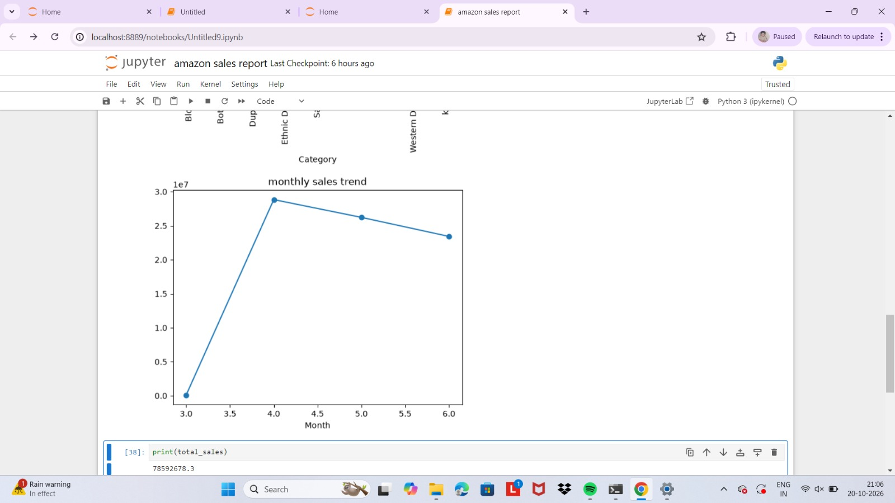
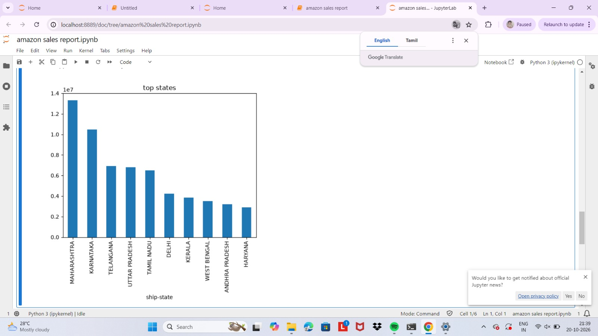
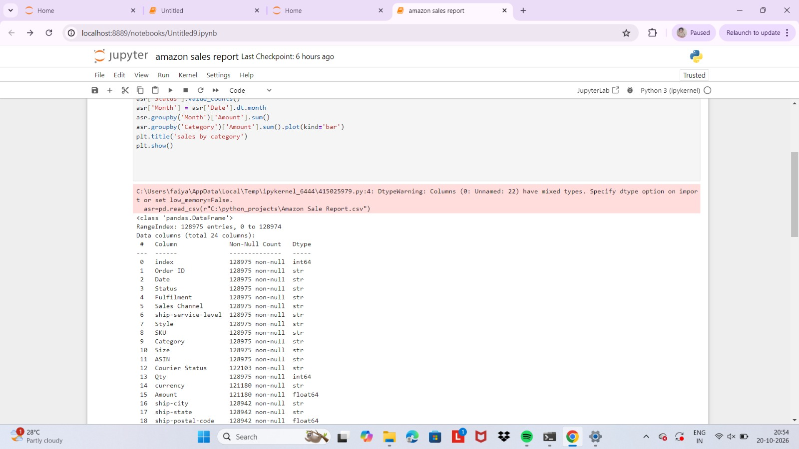
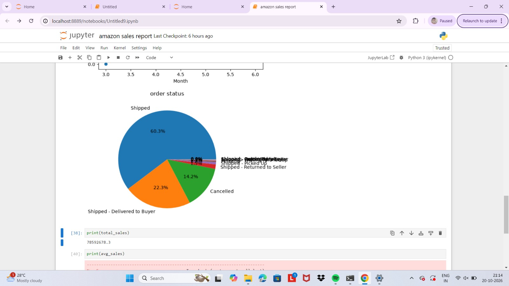
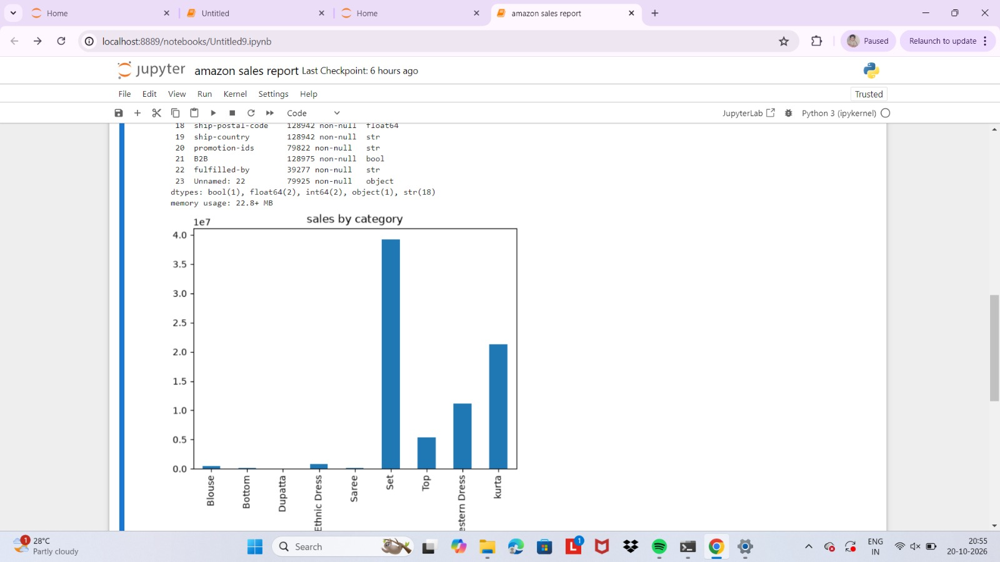

# Amazon Sales & Order Analysis using Python
Tools: Pandas, NumPy, Matplotlib, Jupyter Notebook

Dataset: Amazon Sale Report (Kaggle), 128,975 rows, 24 columns

Contributors: Keerthana, Faiyaz
 
What I did:
- Cleaned data (missing values, duplicates, date conversion)
- Analyzed sales by category, month, and state
- Visualized order status distribution

Key insights:
- Maharashtra and Karnataka are top states
- Set and Kurta are top-selling categories
- ~60% orders Shipped, 14% Cancelled

## Charts

